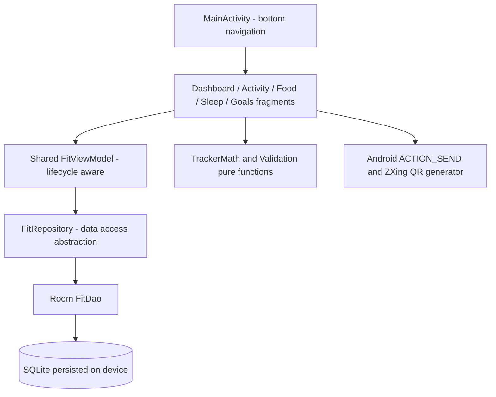

# FitTrack architecture

- **Model:** `Workout`, `Food`, `SleepEntry`, `WaterEntry`, `Goals` Room entities.
- **View:** Activities, fragments, XML Material 3 layouts, RecyclerView.
- **ViewModel:** `FitViewModel` (LiveData/Flow bridge, viewModelScope for coroutine database writes).
- **Repository:** `FitRepository` is the only component accessing `FitDao`.
- **DI:** `FitTrackApp` supplies the repository to `FitViewModel.Factory` (manual constructor injection).
- **Persistence:** Room tables survive process death/restarts. Goals stored as a singleton row.
- **Share:** explicit user-triggered text chooser intent; no account/network permission.
- **QR:** ZXing encodes a small, plain-text local summary for scanning.
- **Lifecycle:** Fragment view binding and RecyclerView adapter are released in `onDestroyView`.

## Notes
Data is stored locally and may be included in Android backups, according to the Android platform's backup settings. The app makes no cloud sync claims. The QR contains potentially private data: users should share it intentionally.
